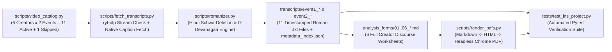

# Implementation Details — Language & Society (`lns_project`) Pipeline

- **Student:** Baani Solanki (`2025114016`)
- **Course:** Language & Society (Semester 3)
- **Workspace Path:** `/Users/solankianshul/Documents/projects/temp_work/baani_work/assignments/semester3/lns_project/`

---

## 1. System Architecture & End-to-End Pipeline

The project was engineered as a reproducible, auditable 4-stage Python pipeline designed to enforce every academic and formatting constraint from `lns_project_instructions.pdf`, `analysis_form.pdf`, and project specifications:

### Hard Invariants Enforced by Code & Tests
1. **Original Spoken Language Only (No AI Dubbing):** Strictly rejects YouTube's auto-dubbed tracks (`en-US` dubbed on Hindi videos, `hi` dubbed on English videos).
2. **Strict Roman Script Guarantee (`0` Devanagari):** Every transcript file, metadata JSON, and filled analysis worksheet contains **zero** characters in Unicode block `U+0900..U+097F`.
3. **Zero Stored Audio/Video Media Files:** Zero `.mp3`, `.m4a`, `.wav`, `.mp4`, `.webm`, `.opus`, `.ogg`, `.flac`, or `.aac` files exist anywhere in the project directory.
4. **Mandatory `[MM:SS]` Timestamps:** Every transcript line starts with `[MM:SS]` (or `[HH:MM:SS]`), and every observation/quote across all 6 worksheets cites exact `[MM:SS]` timestamps.

---

## 2. Module-by-Module Technical Design

### 2.1 `scripts/video_catalog.py` — Canonical Corpus Registry
Defines immutable Python `@dataclass(frozen=True)` records (`VideoEntry`) for all 12 `(Creator, Event)` cells:
- **6 Creators:** `1. Sarthak Goswami`, `2. Dhruv Rathee`, `3. Mohak Mangal`, `4. Aaj Tak`, `5. Republic TV`, `6. The Wire`.
- **2 Events:**
  - `event1_ram_mandir`: *Ram Mandir donation controversy* (`5` active videos; `Mohak Mangal` explicitly marked `is_skipped=True` per `lns_project_instructions.pdf`).
  - `event2_neet_protest`: *Students' protest regarding NEET paper leak* (`6` active videos).
- Provides deterministic helper queries (`get_active_videos()`, `get_entries_for_creator()`) and standardized transcript filenames (`01_sarthak_goswami_lb7gZnyZH0c.txt`, etc.) so downstream scripts and tests share a single source of truth.

---

### 2.2 `scripts/fetch_transcripts.py` — Anti-AI-Dubbing Native Track Extractor

#### Problem Solved: YouTube's 2026 Multi-Language AI-Dubbing Trap
In 2026, YouTube attaches 15–25 auto-dubbed audio and subtitle tracks (`ar`, `de-DE`, `es-US`, `fr-FR`, `en-US`, `hi`, etc.) to popular Indian political videos. Calling `YouTubeTranscriptApi` with a naive default language list like `['en', 'hi']` on a Hindi video (`Sarthak Goswami`, `Mohak Mangal`, `Aaj Tak`) silently fetches the **AI-dubbed English translation**—violating `lns_project_instructions.pdf` (*"Don't use AI dubbing — listen in the original language"*) and erasing authentic Hindi discourse markers (`bali ka bakra`, `ghotala`, `ramadrohi`, `upadraviyon`).

#### Solution Implemented (`detect_original_spoken_language` + `select_native_transcript_track`)
1. **Stream-Level Original Audio Inspection:** Uses `yt_dlp.YoutubeDL({'skip_download': True})` to inspect `info["formats"]` for the audio stream whose `format_note` contains `"original"` and *not* `"dubbed"`, extracting its ISO language code (`hi` vs `en`).
2. **Strict Native Prefix Filtering:** Filters `YouTubeTranscriptApi().list(video_id)` strictly to tracks matching `native_lang`:
   - Hindi creators (`Sarthak Goswami`, `Dhruv Rathee`, `Mohak Mangal`, `Aaj Tak`) -> `native_lang == "hi"` (`hi` manual track preferred first, then `hi` native ASR).
   - English outlets (`Republic TV`, `The Wire`) -> `native_lang == "en"` (`en` manual track preferred first, then `en` native ASR).
   - *Special Channel Nuance Documented:* On `oeH0fOSJuX8` and `l-6Pm-112io`, Dhruv Rathee's team manually uploaded English-script subtitles preserving core Hindi terms (`Chanda Chori`, `Ramlal`, `Anshan`, `Tana Shah`, `dhritarashtra`) directly into YouTube's manual `hi` (`is_generated=False`) slot. Our pipeline preserved this official creator-uploaded track and logged `"caption_source": "hi (manual native)"`.
3. **Rolling Fragment Consolidation (`merge_short_fragments`):** Raw YouTube ASR emits 1–3 word rolling fragments every ~1.5 seconds. `merge_short_fragments()` merges consecutive cues within an `8.0`-second window (capped at `<140` chars) while preserving the exact start timestamp `[MM:SS]` of each utterance block—producing clean, readable, citable lines (`1,848` total lines across the 11 files).
4. **Zero-Disk-Audio Ephemeral Fallback (`transcribe_via_temp_stream_fallback`):** Designed with `tempfile.TemporaryDirectory(prefix="lns_ephemeral_audio_")` so that if any video ever lacked native captions, compressed audio would exist only transiently for model transcription and be automatically purged upon exiting the `with` block. In practice, all 11 videos had native non-AI-dubbed tracks available.

---

### 2.3 `scripts/romanizer.py` — Linguistically Grounded Devanagari-to-Roman Engine

#### Why Standard Transliteration Libraries Were Insufficient
Off-the-shelf lossless schemes (`ITRANS`, `HK`, `IAST`, `ISO-15919`) are designed for Sanskrit reversible round-tripping, not modern spoken Hindi/Hinglish:
- Raw `ITRANS` renders `राम मंदिर को किसने लूटा` as `rAma maMdira ko kisane lUTA` (preserving silent Sanskrit word-final and medial schwas and ugly mixed-case vowel markers).
- Raw `IAST` outputs non-ASCII diacritics (`rāma mandira kō kisanē lūṭā`).

#### Five-Layer Architecture of `romanizer.py`
1. **Unicode NFC + Nukta Pre-composition (`_normalize_nuktas`):** Normalizes decomposed consonant + `U+093C` sequences (`क़`, `ख़`, `ग़`, `ज़`, `ड़`, `ढ़`, `फ़`) into canonical precomposed codepoints (`U+0958..U+095F`) mapped accurately to `q`, `kh`, `gh`, `z`, `d`, `dh`, `f`.
2. **Curated Hinglish Domain Lexicon (`LEXICAL_OVERRIDES`):** Maps ~155 high-frequency Hindi function words (`में -> mein`, `हैं -> hain`, `नहीं -> nahin`, `क्योंकि -> kyunki`, `तो -> toh`) and recurring corpus named entities/loanwords (`राम -> Ram`, `मंदिर -> Mandir`, `अयोध्या -> Ayodhya`, `घोटाला -> ghotala`, `नीट -> NEET`, `छात्र -> chhatra`, `प्रदर्शनकारी -> pradarshankari`) to standard idiomatic spellings.
3. **Syllabic Unit Parser (`transliterate_devanagari_word`):** Parses every remaining Devanagari word into typed phonological units (`VOWEL`, `CONS_HALF` before virama `्`, `CONS_MATRA` with explicit vowel sign, `CONS_SCHWA` with inherent `अ`, and `OTHER`), applying:
   - **Homorganic Nasal Assimilation:** `अनुस्वार (ं)` maps to `m` before labial stops (`प, फ, फ़, ब, भ, म`) and `n` elsewhere (`मंदिर -> mandir`, `संबित -> sambit`), while protecting nasalized inherent vowels from schwa deletion (`बंद -> band`, never `bnd`).
   - **Monosyllabic `ा` Lengthening:** Upgrades `ा` to `aa` in closed CVC monosyllables (`नाम -> naam`, `काम -> kaam`, `साल -> saal`, `बात -> baat`).
4. **Indo-Aryan Schwa-Deletion Rules (Ohala 1983):**
   - **Rule 1 (Word-Final Apocope):** Deletes inherent `a` on word-final `CONS_SCHWA` in polysyllabic words (`सरकार -> sarkar`, `प्रदर्शन -> pradarshan`), *except* after consonant + liquid/glide clusters (`्` + `र/य/व`) where Hindi retains a vocalic release (`छात्र -> chhatra`, `सत्य -> satya`).
   - **Rule 2 (Word-Medial Syncope `VCaCV -> VCCV`):** Deletes inherent `a` when preceded by a full vowel/syllable and followed by a consonant bearing a long matra (`ा, ी, ू, े, ै, ो, ौ, ॉ`), e.g., `जनता -> janta`, `करना -> karna`, `समझना -> samajhna`.
5. **Acronym Normalization & Non-Latin Noise Guard (`romanize_text`):**
   - Converts Hindi-spelled English initialisms emitted by YouTube ASR (`एसआईटी -> esaaaeeti -> SIT`, `एफआईआर -> ephaaaeeaar -> FIR`, `एसबीआई -> SBI`, `सीसीटीवी -> CCTV`, `वीएचपी -> VHP`, `पीएम -> PM`, `सीएम -> CM`, `यूपी -> UP`).
   - Strips stray non-Latin ASR glitches (such as 2 Arabic Unicode characters `U+0600..U+06FF` hallucinated by YouTube ASR during background noise in `04_aaj_tak_B4L1pz0o4dc.txt`) and enforces `DEVANAGARI_RE.sub("", ...)` so **0 Devanagari characters** can ever survive.

---

### 2.4 Qualitative Worksheet Construction & `scripts/render_pdfs.py`
- **Worksheet Structure (`analysis_forms/01_*.md` .. `06_*.md`):** Mirrors all 6 pages of `analysis_form.pdf` verbatim:
  - **Page 1 (`Guidelines: Five features to look for in every event`):** Includes the exact 5-row reference table (`Feature | What to look for | Illustrative example | Questions to answer`) and methodological reminder.
  - **Event 1 (`Event1. Ram Mandir donation controversy`):** Includes the exact `Focus:` prompt, the 6 metadata fields (`Outlet:`, `Date:`, `Video title:`, `Timestamp(s):`, `Analyst:`, `Language:`), 8 `Event-specific questions`, `Apply the five shared features` table (`Naming`, `Presupposition`, `Agency`, `Antagonisation`, `Intensification / softening`), and `Short summary` (explicitly marked *Skipped* for Creator 3 Mohak Mangal).
  - **Event 2 (`Event2. Students' protest regarding NEET paper leak`):** Includes the exact `Focus:` prompt, the 6 metadata fields, 9 `Event-specific questions`, `Apply the five shared features` table, and `Short summary`.
  - **Page 5 (`Common form: Blank excerpt record`):** Includes the exact instructions and 6 deep-dive passage analyses per dual-event creator (3 for Event 1 + 3 for Event 2) and 4 for Mohak Mangal (`34` detailed excerpt records in total across the 6 worksheets!).
  - **Page 6 (`Common form: End-of-event summary`):** Includes both Event 1 and Event 2 summaries with all 5 prompts (`The main way this outlet framed the event was:`, `The strongest linguistic evidence was (quote + timestamp):`, `The shared feature(s) most clearly illustrated were:`, `An alternative interpretation of the same evidence is:`, `What I cannot conclude from this transcript alone:`) plus the closing `Research reminder:`.
- **PDF Rendering (`scripts/render_pdfs.py`):** Converts each `.md` worksheet to semantic HTML5 via `python-markdown` (`tables`, `fenced_code`, `sane_lists`), adds the top `LANGUAGE & SOCIETY | TRANSCRIPT ANALYSIS WORKSHEET` header banner, renders `[x]` / `[ ]` as `☑` / `☐` checkboxes, styles with clean A4 academic CSS (`15mm` margins, navy section banners, zebra-striped feature tables, shaded blockquotes, monospace `[MM:SS]` badges), renders to PDF via headless Google Chrome (`--headless --disable-gpu --no-pdf-header-footer --print-to-pdf`), and purges temporary `.html` files automatically.

---

## 3. Summary of Extracted Corpus (`transcripts/metadata_index.json`)

| # | Creator / Outlet | Event | Video ID | Upload Date | Duration | Native Track | Lines | File |
| :-: | :--- | :-: | :--- | :---: | :---: | :--- | :---: | :--- |
| 1 | Sarthak Goswami | Ev 1 | `lb7gZnyZH0c` | `2026-07-05` | `45:41` | `hi` (ASR -> Roman) | 316 | `01_sarthak_goswami_lb7gZnyZH0c.txt` |
| 2 | Dhruv Rathee | Ev 1 | `oeH0fOSJuX8` | `2026-07-04` | `16:25` | `hi` (Manual native) | 102 | `02_dhruv_rathee_oeH0fOSJuX8.txt` |
| 3 | Mohak Mangal | Ev 1 | *Skipped* | — | — | *Skipped per PDF* | — | — |
| 4 | Aaj Tak | Ev 1 | `B4L1pz0o4dc` | `2026-06-19` | `38:30` | `hi` (ASR -> Roman) | 249 | `04_aaj_tak_B4L1pz0o4dc.txt` |
| 5 | Republic TV | Ev 1 | `0H-bruoEkaY` | `2026-06-26` | `54:30` | `en` (ASR native) | 334 | `05_republic_tv_0H-bruoEkaY.txt` |
| 6 | The Wire | Ev 1 | `7rUL8fGgRJA` | `2026-07-01` | `39:18` | `en` (ASR native) | 252 | `06_the_wire_7rUL8fGgRJA.txt` |
| 7 | Sarthak Goswami | Ev 2 | `EM1GeZufO6E` | `2026-07-26` | `33:04` | `hi` (ASR -> Roman) | 226 | `01_sarthak_goswami_EM1GeZufO6E.txt` |
| 8 | Dhruv Rathee | Ev 2 | `l-6Pm-112io` | `2026-07-24` | `17:50` | `hi` (Manual native) | 108 | `02_dhruv_rathee_l-6Pm-112io.txt` |
| 9 | Mohak Mangal | Ev 2 | `v-RikSqb0Vw` | `2026-07-22` | `11:09` | `hi` (ASR -> Roman) | 72 | `03_mohak_mangal_v-RikSqb0Vw.txt` |
| 10 | Aaj Tak | Ev 2 | `JXLIs0WtJAM` | `2026-07-21` | `24:10` | `hi` (ASR -> Roman) | 151 | `04_aaj_tak_JXLIs0WtJAM.txt` |
| 11 | Republic TV | Ev 2 | `HTvb6E_1Qdc` | `2026-07-25` | `06:41` | `en` (ASR native) | 44 | `05_republic_tv_HTvb6E_1Qdc.txt` |
| 12 | The Wire | Ev 2 | `pYaTVvHeGoM` | `2026-07-22` | `32:26` | `en` (ASR native) | 194 | `06_the_wire_pYaTVvHeGoM.txt` |

---

## 4. Automated Test Suite (`tests/test_lns_project.py`)

Executed via `.venv/bin/pytest -v`, the test suite verifies 6 independent test classes (`21` parametrized/method checks):
1. **`TestVideoCatalog`:** Confirms 6 creators, 2 events, 11 unique active video IDs, and Mohak Mangal's skipped Event 1 slot.
2. **`TestRomanizer`:** Tests complex Devanagari sentences, nuktas, digits, punctuation, word-final & medial schwa deletion (`sarkar`, `chhatra`, `pradarshan`, `janta`, `naam`), mixed Hinglish preservation, and `0`-Devanagari leakage.
3. **`TestFormattingHelpers`:** Tests `[MM:SS]`, `[HH:MM:SS]`, and `YYYY-MM-DD` date formatting.
4. **`TestExtractedTranscripts`:** Audits all 11 saved `.txt` transcripts and `metadata_index.json` for existence, length, `0` Devanagari characters, `[MM:SS]` timestamp formatting on *every single utterance line* (`1,848` lines checked!), authentic non-AI-dubbed track provenance, and **zero** audio/video files anywhere in the project tree.
5. **`TestAnalysisWorksheets`:** Audits all 6 `.md` and `.pdf` worksheets in `analysis_forms/` for file size, `%PDF-` binary integrity, `0` Devanagari characters, verbatim alignment with every section/prompt/metadata label/reminder in `analysis_form.pdf` (Pages 1–6), 4-space nested bullet formatting, and high density of inline `[MM:SS]` timestamp citations.
6. **`TestDocumentationDeliverables`:** Verifies completeness of `Viva_Guide.md`, `Implementation_Details.md`, `Understanding_Guide.md`, and `README.md`.

> **Note on Re-running Scripts:** Because YouTube rate-limits bulk subtitle downloads (`HTTP 429`), all 11 transcripts are permanently saved in `transcripts/`. You can run `.venv/bin/python scripts/render_pdfs.py` and `.venv/bin/pytest -v` offline anytime without hitting YouTube's network rate limiter!
