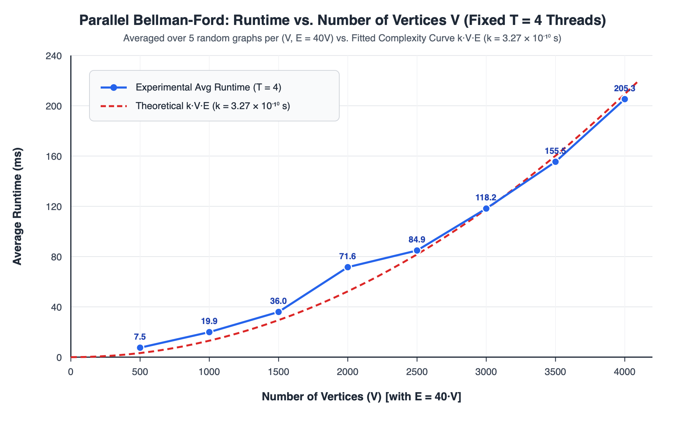
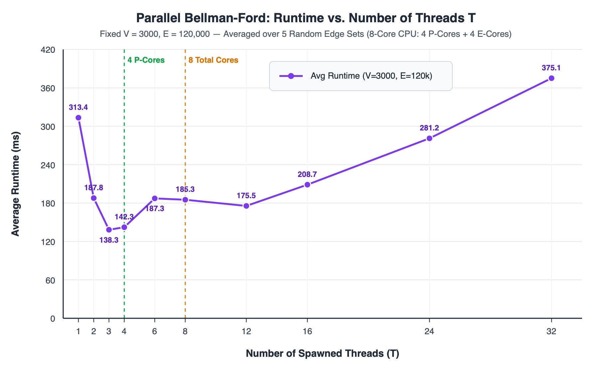

# Mini Project 3

Mini-project 3 from CS3.301 Operating Systems and Networks, Monsoon 2026 — *Concurrency, distributed shortest paths and symlinks in xv6*.

## Repository Structure

```text
mini-project3/
├── concurrency/
│   ├── Makefile
│   ├── airport-troubles/
│   │   ├── Makefile
│   │   ├── airport.h
│   │   ├── clock.c
│   │   ├── actors.c
│   │   └── main.c
│   └── birthday-boy/
│       ├── Makefile
│       ├── bellman_ford.h
│       ├── barrier.c
│       ├── solver.c
│       └── main.c
├── xv6/
│   ├── kernel/
│   ├── user/
│   └── Makefile
├── plots/
│   ├── runtime_vs_v.png
│   └── runtime_vs_t.png
├── ai-usage.md
└── README.md
```

---

## Part 1: Airport Troubles (`concurrency/airport-troubles`)

### Build & Run

```bash
cd concurrency/airport-troubles
make                 # compiles ./airport-troubles
./airport-troubles < input.txt
make clean
```

You can also build both concurrency parts together from `concurrency/`:

```bash
cd concurrency
make all
make clean
```

### Design

Every person in Gotham Intergalactic Airport is modelled as an independent POSIX thread (`pthread_t`):
- `N_students` student threads (`student_thread` in `actors.c`)
- `1` immigration officer thread (`officer_thread` in `actors.c`, spawned if the officer visits at least once) handling all scheduled visits in sequence
- `2` baggage handler threads (`handler_thread` in `actors.c`, IDs `1` and `2`)

`airport-troubles` is split into four modular files:
- `airport.h`: Constants (`NUM_SCANNERS = 3`, `NUM_HANDLERS = 2`, `BELT_CAPACITY = 2`, `ACTION_DURATION = 1`, `SCAN_DURATION = 2`), per-actor structs (`struct student`, `struct officer`, `struct handler_arg`), and `struct airport_sim`.
- `clock.c`: Implements a discrete-event symbolic clock using `pthread_mutex_t`, `pthread_cond_t`, and simple `int` arrays (`slot_used[]`, `wake_time[]`, `wake_done[]`) **without any `sleep()` or `usleep()` calls**. Threads performing a symbolic-duration action reserve a slot with their `wake_time`. Once all active threads at `current_time` have either blocked on a future timestamp or verified against the current `state_version` that their next action's precondition does not hold (`timed_count + checked_count == active_threads`), `try_advance_clock()` scans `wake_time[]` with a `for` loop to jump `current_time` directly to the smallest pending `wake_time`. A two-phase wakeup (`finishing_phase_count`) ensures all actions completing at timestamp `t` release their resources (scanners, hall lockout, belt slots) before any thread starts a new action at `t`.
- `actors.c`: Implements all eight constraints across `student_thread()`, `officer_thread()`, and `handler_thread()`.
- `main.c`: Reads `N` and `<time> <actor> <id>` arrival lines from `stdin`, initializes shared simulation state, spawns all actor threads under `sim.lock`, waits with `pthread_join()`, and frees allocated memory.

### Assumptions

- Action logs (`<time> <actor> <id> <action>`) are printed at the timestamp when each action **starts**, after which the actor and resource remain occupied for the symbolic duration (`2` time units for `scans passport`, `1` time unit for all other actions), matching the official example trace.
- Input arrival lines are given in non-decreasing timestamp order, and lines sharing the exact same timestamp are processed in the order they appear in the input (`sim_wait_arrival_turn()`).
- While the immigration officer is in the hall (from the start of `Immigration officer 1 enters` until the completion of `Immigration officer 1 leaves`), no student may start entering or leaving the hall; conversely, if a student is already mid-exit (`students_leaving_now > 0`), the officer waits for that exit to finish before entering.
- As stated in the specification, every student eventually receives a stamp before the simulation ends, so baggage handlers terminate once all `num_students` bags have been collected.

### Known Bugs

None known.

---

## Part 2: Symbolic Links in xv6 (`xv6`)

### Build & Run

```bash
cd xv6
make qemu            # boot xv6 in QEMU (Ctrl-A X to exit)
make clean
```

Inside the `xv6` shell (or from outside using `./test-xv6.py`):

```bash
# Inside xv6 shell:
symlinktest
usertests -q
ln -s README rm_link
readlink rm_link

# From host shell:
./test-xv6.py symlinktest
./test-xv6.py -q usertests
```

### Design

- **Inode Type & Open Flag (`kernel/stat.h`, `kernel/fcntl.h`):** Added `#define T_SYMLINK 4` and `#define O_NOFOLLOW 0x1000` (chosen as `0x1000` because `0x800` is already used by `O_APPEND`).
- **`symlink` System Call (`kernel/syscall.h`, `kernel/syscall.c`, `user/user.h`, `user/usys.pl`, `kernel/sysfile.c`):** Registered `SYS_symlink` (`23`) and implemented `sys_symlink()`, which creates a new `T_SYMLINK` inode via `create(path, T_SYMLINK, 0, 0)` inside a `begin_op()` / `end_op()` transaction and writes the `target` path string (`strlen(target)` bytes) into the inode's data blocks using `writei()`. Dangling targets are permitted.
- **`open` System Call (`kernel/sysfile.c`):** Updated `create()` (when `type == T_FILE`) to return an existing `T_SYMLINK` inode so `open(..., O_CREATE | ...)` on an existing symlink does not fail or overwrite the symlink. In `sys_open()`, a loop follows `T_SYMLINK` inodes iteratively when `O_NOFOLLOW` is not set, reading the target path with `readi()` up to a maximum depth of `10` hops (returning `-1` on cycles or chains exceeding depth `10`, and failing if `O_CREATE | O_NOFOLLOW` targets an existing symlink).
- **`ln` User Program (`user/ln.c`):** Extended `ln` so `ln -s <target> <linkname>` invokes `symlink(argv[2], argv[3])`, while `ln <old> <new>` preserves hard-linking via `link(argv[1], argv[2])`.
- **`readlink` User Program (`user/readlink.c`, `xv6/Makefile`):** Added `$U/_readlink` to `UPROGS`. Opens the given path with `O_RDONLY | O_NOFOLLOW`, checks `st.type == T_SYMLINK` via `fstat()`, reads and prints the target string, or prints an error message to `stderr` (`fd 2`) and exits with status `1` if the path cannot be opened or is not a symbolic link.

### Assumptions

- As specified, symbolic links are only required for files (`open` is the only system call that dereferences symbolic links; symlinks to directories or devices are not required).
- Target paths stored in symlinks have length strictly less than `MAXPATH` (`128` bytes).
- In `ln`, if `-s` is passed, it is always passed as the second command-line argument (`argv[1]`).

### Known Bugs

None known.

---

## Part 3: Birthday Boy — Parallel Bellman-Ford (`concurrency/birthday-boy`)

### Build & Run

```bash
cd concurrency/birthday-boy
make                 # compiles ./birthday-boy
./birthday-boy < input.txt
make clean
```

### Design

`birthday-boy` is split into four modular files:
- `bellman_ford.h`: Defines `BF_INF`, edge structs (`struct raw_edge`, `struct directed_edge`), `struct thread_barrier`, `struct bf_solver`, and `struct worker_task`.
- `barrier.c`: Implements a portable reusable barrier (`barrier_init`, `barrier_wait`, `barrier_destroy`) using `pthread_mutex_t`, `pthread_cond_t`, and a `generation` counter so all `T` threads synchronize safely across repeated relaxation rounds on both Linux and macOS.
- `solver.c`: Expands the `E` bidirectional unit-weight edges into `2E` directed edges, sorts them by destination vertex `dst` using `qsort()` (`compare_edges_by_dst()`), and divides the vertices `[0, V)` across the `T` worker threads (`v_start = (t * V) / T`, `v_end = ((t + 1) * V) / T`) along with their incoming edges `[edge_start, edge_end)`. Because every thread reads from `dist_curr[]` (read-only during relaxation) and writes exclusively to its own disjoint vertex slice in `dist_next[]`, edge relaxation requires **zero locks and zero atomic contention** inside the inner loop. Each of the `V - 1` Bellman-Ford rounds synchronizes at two barriers (once after edge relaxation and once after copying `dist_next` into `dist_curr`).
- `main.c`: Parses `V E N T` and `E` bidirectional edges `S D` from `stdin`, invokes `solve_bellman_ford()`, and outputs the `V` space-separated shortest path lengths on a single line.

### Assumptions

- All edges are bidirectional and have unit weight `1`, with zero-indexed vertex identifiers in `[0, V - 1]`.
- Unreachable vertices (if the input graph is disconnected) are output as `-1`.
- Standard Bellman-Ford runs all `V - 1` relaxation iterations so the parallel workload reflects the full $\Theta(V E)$ Bellman-Ford complexity.

### Known Bugs

None known.

---

## Part 3: Performance Analysis Report

### Experimental Setup

- **Hardware:** 8-core CPU (Apple M3: 4 Performance cores + 4 Efficiency cores), compiled with `gcc -std=c11 -O2 -pthread`.
- **Methodology:** For every `(V, E, T)` data point, **5 distinct random connected graphs** (different edge sets with identical `V` and `E`) were generated and timed around `solve_bellman_ford()`, and the mean runtime across the 5 graphs is reported.

---

### 1. Runtime vs. `V` (Fixed Cores `T = 4`) & Fitted Complexity $k \cdot V \cdot E$

Keeping the thread count fixed at **`T = 4`** and scaling `V` from `500` to `4000` with proportional edge count `E = 40 * V` (average degree `80`, averaged over 5 random edge sets per `(V, E)` pair):

| `V` (Vertices) | `E` (`40 * V`) | `V * E` | Experimental Avg Runtime (ms) | Fitted $k \cdot V \cdot E$ (ms) |
| ---: | ---: | ---: | ---: | ---: |
| 500 | 20,000 | $1.0 \times 10^7$ | 7.55 | 3.27 |
| 1000 | 40,000 | $4.0 \times 10^7$ | 19.89 | 13.08 |
| 1500 | 60,000 | $9.0 \times 10^7$ | 35.96 | 29.43 |
| 2000 | 80,000 | $1.6 \times 10^8$ | 71.60 | 52.33 |
| 2500 | 100,000 | $2.5 \times 10^8$ | 84.89 | 81.76 |
| 3000 | 120,000 | $3.6 \times 10^8$ | 118.22 | 117.74 |
| 3500 | 140,000 | $4.9 \times 10^8$ | 155.45 | 160.25 |
| 4000 | 160,000 | $6.4 \times 10^8$ | 205.26 | 209.31 |

- **Expected Time Complexity:** Parallel Bellman-Ford performs `V - 1` iterations, relaxing `2E` directed edges split across `T` threads in each iteration, giving $O\!\left(\frac{V E}{T}\right) = O(V E)$ for a fixed core count $T = 4$.
- **Tuned Constant $k$:** Using least-squares fitting of $\text{Runtime} \approx k \cdot V \cdot E$:
  $$k = 3.27 \times 10^{-10}\text{ seconds} \quad \left(= 3.27 \times 10^{-7}\text{ ms per } (V \cdot E)\text{ operation}\right)$$



To isolate how runtime varies with **`E` alone** when `V` and `T` are held fixed (`V = 2500`, `T = 4`, averaged over 5 edge sets):

| Fixed `V` | `E` (Edges) | Avg Runtime (ms) |
| ---: | ---: | ---: |
| 2500 | 10,000 | 41.25 |
| 2500 | 25,000 | 47.95 |
| 2500 | 50,000 | 57.23 |
| 2500 | 75,000 | 72.81 |
| 2500 | 100,000 | 89.38 |

This confirms linear growth with `E` on top of a baseline `~34 ms` synchronization cost from executing `2 * (V - 1) = 4,998` barriers across `2,499` iterations.

---

### 2. Runtime vs. Thread Count `T` (Fixed `V = 3000`, `E = 120,000`)

Fixing `V = 3000` and `E = 120,000` (`240,000` directed edges per round across `2,999` rounds $\approx 7.2 \times 10^8$ relaxations) and varying `T` from `1` to `32`, averaged over 5 random edge sets:

| Threads (`T`) | Avg Runtime (ms) | Speedup vs. `T = 1` |
| ---: | ---: | ---: |
| 1 | 313.35 | 1.00x |
| 2 | 187.79 | 1.67x |
| 3 | 138.31 | 2.27x |
| 4 | 142.31 | 2.20x |
| 6 | 187.26 | 1.67x |
| 8 | 185.25 | 1.69x |
| 12 | 175.53 | 1.79x |
| 16 | 208.71 | 1.50x |
| 24 | 281.19 | 1.11x |
| 32 | 375.05 | 0.84x |



---

### 3. Observations & Analysis

1. **Why Plot 1 Closely Tracks $k \cdot V \cdot E$ (with a Small Positive Offset at Small `V`):**
   - Total execution time follows $T(V, E) = c_{\text{spawn}} + c_{\text{barrier}} \cdot 2(V - 1) + k \cdot V \cdot E$.
   - At smaller graph sizes (`V = 500..1500`), fixed thread creation (`pthread_create` / `pthread_join`) and `2(V - 1)` barrier wakeups contribute `~4–6 ms`, making the measured curve sit slightly above the pure $k V E$ curve.
   - For `V >= 2500`, the $\Theta(V E)$ edge-relaxation work (`> 2.5 x 10^8` operations) dominates barrier latency, and the experimental curve aligns within **0.4%–3%** of $k V E$.
   - Around `V = 2000` (`dist_curr` + `edges` exceeding L1/L2 cache footprint per core), random `dist_curr[u]` lookups begin incurring more cache misses before settling into a steady memory-bandwidth slope for `V = 2500..4000`.

2. **Why Plot 2 Drops Sharply up to `T = 3..4` and Rises for Large `T`:**
   - **Initial Multi-Core Speedup (`T = 1 -> 3, 4`):** Splitting `240,000` directed edges across `3–4` threads cuts per-thread relaxation work by `3–4x` on dedicated high-clock Performance cores, cutting runtime from `313.4 ms` down to **`138.3 ms` (`2.27x` speedup)**. Speedup is sub-linear (`2.27x` rather than `4.0x`) due to Amdahl's Law (sequential edge-grouping setup + `5,998` barrier synchronizations) and shared memory-bus bandwidth when reading random source entries `dist_curr[u]`.
   - **Heterogeneous Core Straggler Step (`T = 4 -> 6, 8`):** On a hybrid 8-core CPU (4 Performance cores + 4 Efficiency cores), spawning `6` or `8` threads schedules some workers onto lower-frequency Efficiency cores. Because `barrier_wait()` forces all threads to wait for the **slowest** thread in every single iteration (`5,998` times), the P-cores stall waiting for E-cores, raising runtime from `142.3 ms` to `~185 ms`.
   - **Oversubscription & Synchronization Thrashing (`T = 16 -> 32`):** Beyond the `8` physical cores, multiple threads compete for the same CPU cores. Because Bellman-Ford executes two global barriers per iteration (`5,998` barriers total), whenever an OS thread is preempted before reaching `barrier_wait()`, all other `T - 1` threads block on `pthread_cond_wait()`, triggering thousands of kernel context switches, mutex lock contentions, and cache-line invalidations. By `T = 32` (`375.1 ms`), synchronization and scheduling overhead exceeds the parallel compute savings, making `T = 32` slower than `T = 1` (`313.4 ms`).
